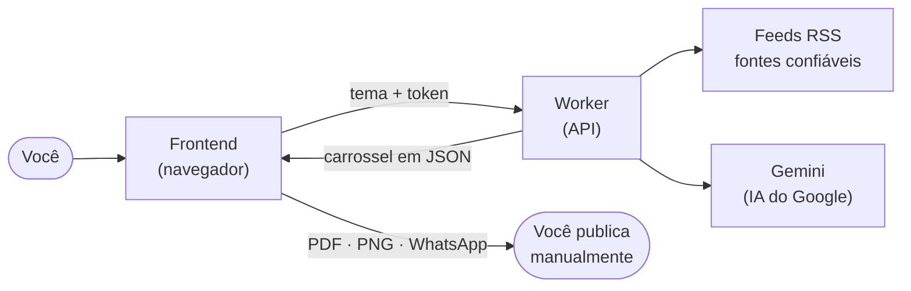
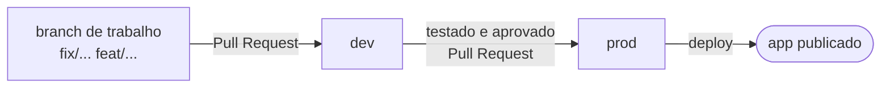

# Pauta Pronta

**Do tema ao carrossel pronto para revisar, em minutos.**

O Pauta Pronta é uma ferramenta web que, a partir de um tema, consulta fontes confiáveis e monta um
**rascunho de carrossel** para LinkedIn e Instagram, já no padrão visual de quem publica, com:

- 4 a 7 slides (capa, contexto, pontos e conclusão);
- legenda para LinkedIn e legenda para Instagram;
- 3 a 5 hashtags e uma pergunta final (CTA);
- a lista de fontes citadas, com aviso quando uma fonte precisa ser conferida.

Você revisa, ajusta o que quiser e exporta (PDF, imagens ou WhatsApp). **A publicação continua manual**:
o app nunca posta nada sozinho.

> Projeto de prática extensionista (ADS — PUCPR), desenvolvido para o Lucivandro Luz.
> Custo para usar: **R$ 0** (só serviços gratuitos, sem cartão cadastrado).

---

## Sumário

1. [Como funciona](#1-como-funciona)
2. [O que tem em cada pasta](#2-o-que-tem-em-cada-pasta)
3. [Rodando na sua máquina](#3-rodando-na-sua-máquina)
4. [Usando o app](#4-usando-o-app)
5. [Modo assistido (quando a cota acaba)](#5-modo-assistido-quando-a-cota-acaba)
6. [Por que o custo é zero](#6-por-que-o-custo-é-zero)
7. [Branches e fluxo de trabalho](#7-branches-e-fluxo-de-trabalho)
8. [Testes](#8-testes)
9. [Segurança e privacidade](#9-segurança-e-privacidade)
10. [Publicando (deploy)](#10-publicando-deploy)
11. [Manutenção do dia a dia](#11-manutenção-do-dia-a-dia)
12. [Problemas comuns](#12-problemas-comuns)
13. [Documentação do projeto](#13-documentação-do-projeto)

---

## 1. Como funciona

São só duas peças:

| Peça | O que faz | Onde roda |
|---|---|---|
| **Frontend** (React) | Telas, desenho dos slides, edição e exportação. Guarda ideias, histórico e configurações **no próprio navegador**. | Cloudflare Pages |
| **Worker** (API) | Guarda a chave da IA em segredo, lê os feeds RSS, chama o Gemini e confere a resposta. | Cloudflare Workers |



**O caminho de uma geração:**

1. Você digita um tema e clica em **Gerar**.
2. O frontend envia o tema ao Worker, junto com o seu token de acesso.
3. O Worker confere o token e o limite do dia, lê os feeds RSS cadastrados e pede à IA o carrossel.
4. A resposta é validada (quantidade de slides, tamanho dos textos, fontes). Se vier fora do formato,
   o Worker pede uma correção à IA uma vez.
5. Cada fonte citada é comparada com os sites realmente consultados. As que não batem aparecem com o selo
   **"verificar"**.
6. O carrossel abre na tela **Revisão**, onde você edita tudo e vê os slides mudando na hora.

Os diagramas completos (sequências, telas, modelo de dados) estão em
[`docs/DIAGRAMAS.md`](docs/DIAGRAMAS.md).

---

## 2. O que tem em cada pasta

Este repositório é um **monorepo**: frontend, API e código compartilhado vivem juntos e são instalados com
um único `npm install` (via *npm workspaces*).

```text
.
├── frontend/              # App React (Vite)
│   ├── public/_headers    #   cabeçalhos de segurança do Cloudflare Pages
│   └── src/
│       ├── components/    #   telas e partes da interface
│       ├── canvas/        #   desenho dos slides e exportação (PNG, ZIP, PDF, WhatsApp)
│       ├── state/         #   dados salvos no navegador (rascunho, ideias, histórico, config)
│       └── api.js         #   conversa com o Worker
├── worker/                # API no Cloudflare Workers (Hono)
│   ├── src/               #   rotas, RSS, Gemini, verificação de fontes, limites, cron
│   └── wrangler.toml      #   configuração (nome, cron, KV, variáveis públicas)
├── shared/                # Usado pelo frontend E pelo Worker
│   ├── schema.js          #   formato do carrossel e regras de validação
│   ├── prompt.js          #   textos enviados à IA (inclusive o do modo assistido)
│   └── fixtures/          #   carrossel de exemplo
├── scripts/smoke.mjs      # Teste rápido da API rodando
├── docs/                  # Diagramas, contas, roteiro de testes de aceitação
├── prompts/               # Passo a passo por fase (usado com agente de código)
├── PLANO_EXECUCAO.md      # Plano do MVP, decisões técnicas e riscos
└── PROGRESSO.md           # O que já foi feito e validado
```

**Por que existe a pasta `shared/`?** As regras do carrossel (quantos slides, tamanho do título etc.) e o texto
enviado à IA precisam ser **iguais** no navegador e no servidor. Ficando num lugar só, o modo assistido valida
exatamente como a API valida, e não há duas versões para manter.

---

## 3. Rodando na sua máquina

### Pré-requisitos

- [Node.js](https://nodejs.org) 20 ou mais novo (`node -v` para conferir);
- [Git](https://git-scm.com);
- para gerar com IA: uma chave gratuita do Google AI Studio (veja [`docs/SETUP_CONTAS.md`](docs/SETUP_CONTAS.md)).
  **Sem a chave, o app funciona no modo assistido e com o carrossel de exemplo.**

### Passo a passo

**1. Baixe o projeto e instale as dependências**

```bash
git clone https://github.com/BossBurgues/PautaPronta.git
```

```bash
cd PautaPronta
```

```bash
npm install
```

**2. Configure os segredos do Worker**

Copie o arquivo de exemplo e preencha com seus valores:

```bash
cp worker/.dev.vars.example worker/.dev.vars
```

Abra `worker/.dev.vars` num editor e preencha:

```ini
GEMINI_API_KEY=sua-chave-do-ai-studio
ACCESS_TOKEN=um-token-longo-e-aleatorio
```

Para gerar um token seguro:

```bash
node -e "console.log(require('crypto').randomBytes(24).toString('base64url'))"
```

> O `.dev.vars` está no `.gitignore`: ele **nunca** vai para o GitHub. Não cole a chave em nenhum outro arquivo.

**3. Suba a API e o app (dois terminais)**

Terminal 1, a API em `http://localhost:8787`:

```bash
npm run dev:worker
```

Terminal 2, o app em `http://localhost:5173`:

```bash
npm run dev:front
```

**4. Conecte o app à API**

Abra `http://localhost:5173`, vá na aba **Config → Acesso**, cole o mesmo `ACCESS_TOKEN` do passo 2 e clique em
**Testar conexão**.

### Comandos úteis

| Comando | O que faz |
|---|---|
| `npm run dev:front` | Sobe o app em modo desenvolvimento |
| `npm run dev:worker` | Sobe a API localmente |
| `npm test` | Roda todos os testes automatizados |
| `npm run build` | Gera a versão de produção do app em `frontend/dist` |
| `npm run smoke` | Testa a API rodando (sem gastar cota da IA) |
| `npm run smoke -- --real` | Faz também uma geração real (gasta 1 uso da cota) |

---

## 4. Usando o app

O app tem cinco abas:

| Aba | Para quê |
|---|---|
| **Gerar** | Digite o tema, escolha formatos e nº de slides, ligue (ou não) a busca na web e clique em **Gerar**. No topo aparecem as **Sugestões da semana**. |
| **Revisão** | Edite títulos, textos, legendas, CTA, hashtags e fontes. Os slides se atualizam na hora. No celular, use o seletor **Editar / Prévia**. |
| **Ideias** | Guarde temas e links para depois. O botão **Gerar a partir desta ideia** leva o tema para a aba Gerar. |
| **Histórico** | As últimas 20 gerações. **Abrir na revisão** traz uma delas de volta. |
| **Config** | Identidade visual (logo, cores, fonte, @), feeds RSS, padrões de geração, acesso à API e **backup dos dados**. |

### Exportar

Na Revisão, o painel **Exportar e Publicar** oferece:

| Botão | Resultado | Onde usar |
|---|---|---|
| PDF (LinkedIn) | Um PDF com uma página por slide | Post de documento/carrossel no LinkedIn |
| ZIP de imagens (Instagram) | `slide-01.png`, `slide-02.png`… em 1080×1350 | Carrossel do Instagram |
| Imagem para WhatsApp | Um JPEG com os slides em grade | Enviar uma prévia rápida |
| Copiar legenda | Legenda + CTA + hashtags (+ fontes no LinkedIn) | Colar no post |

Cada slide também tem um botão **Baixar PNG** próprio.

### Dicas de revisão

- **Contador vermelho** = texto acima do limite. O slide reduz a fonte sozinho, mas o ideal é encurtar.
- **Selo "verificar"** numa fonte = a URL não apareceu entre os sites consultados. Abra e confira antes de publicar.
- O rascunho é salvo automaticamente no navegador; pode fechar e voltar depois.
- **Descartar rascunho** (no topo da Revisão) limpa o carrossel atual para começar outro.

---

## 5. Modo assistido (quando a cota acaba)

A cota gratuita da IA tem limite diário. Quando ela acaba (ou a API está fora do ar), o app abre sozinho o
**modo assistido**, que funciona sem servidor e sem custo:

1. Clique em **Copiar prompt**.
2. Cole num assistente gratuito ([Gemini](https://gemini.google.com), [ChatGPT](https://chatgpt.com) etc.).
3. Copie a resposta (o bloco JSON) e cole na caixa **Cole aqui a resposta da IA**.
4. Clique em **Usar resposta**. Se algo estiver fora do formato, o app lista o problema e gera um
   **pedido de correção** para você colar de volta no assistente.

Também dá para entrar no modo assistido a qualquer momento pelo botão **Modo assistido** na aba Gerar.

---

## 6. Por que o custo é zero

- **Hospedagem**: Cloudflare Pages e Workers no plano gratuito.
- **IA**: Google AI Studio no nível gratuito, **sem conta de faturamento vinculada**. Quando a cota acaba, o Google
  responde "limite atingido" (erro 429) em vez de cobrar, e o app cai no modo assistido.
- **Limite próprio**: o Worker aceita no máximo `DAILY_LIMIT` gerações por dia (padrão 20), para proteger a cota.
- As contas ficam no nome do Lucivandro e **sem cartão cadastrado**. Checklist em
  [`docs/SETUP_CONTAS.md`](docs/SETUP_CONTAS.md).

---

## 7. Branches e fluxo de trabalho

| Branch | Papel | Quem escreve |
|---|---|---|
| `prod` | O que está **publicado** para o Lucivandro. Só recebe código testado. | Merge de `dev`, nunca commit direto |
| `dev` | Integração: onde as mudanças se juntam e são testadas. É a branch padrão. | Merge das branches de trabalho |
| `feat/...`, `fix/...`, `docs/...` | Uma branch por tarefa | Você ou o agente de código |

O fluxo, na prática:



**Passo a passo de uma mudança:**

```bash
git switch dev
```

```bash
git pull
```

```bash
git switch -c fix/descricao-curta
```

Faça as alterações, rode `npm test` e `npm run build`, e então:

```bash
git add -A
```

```bash
git commit -m "fix: descrição curta do que mudou"
```

```bash
git push -u origin fix/descricao-curta
```

Abra o Pull Request para `dev` no GitHub. Depois de testar em `dev`, abra outro Pull Request de `dev` para `prod`.

**Mensagens de commit** começam com o tipo: `feat:` (funcionalidade), `fix:` (correção), `docs:` (documentação),
`test:` (testes), `chore:` (manutenção), `refactor:` (reorganização sem mudar comportamento).

O andamento das tarefas fica no [quadro do projeto no GitHub](https://github.com/users/BossBurgues/projects/3)
e em [`PROGRESSO.md`](PROGRESSO.md).

---

## 8. Testes

```bash
npm test
```

Os testes automatizados (Vitest) cobrem as regras do carrossel, a montagem dos prompts, a leitura de RSS, a
verificação de fontes, o token, a edição do rascunho, a quebra de texto dos slides e a exportação de legendas.

Com a API rodando (`npm run dev:worker`), o teste de fumaça confere as rotas de verdade:

```bash
npm run smoke
```

Antes de levar algo para `prod`, siga o roteiro manual em
[`docs/TESTES_ACEITACAO.md`](docs/TESTES_ACEITACAO.md).

---

## 9. Segurança e privacidade

O que o projeto faz para se proteger:

| Risco | Proteção |
|---|---|
| Vazamento da chave da IA | A chave fica só no Worker (`wrangler secret` / `.dev.vars`), nunca no navegador nem no Git |
| Uso indevido da API | Token obrigatório (`Authorization: Bearer`), comparado em tempo constante, e limite diário |
| Outros sites chamando a API | CORS liberado só para o endereço do app (`ALLOWED_ORIGIN`) |
| Scripts maliciosos na página (XSS) | React escapa todo texto; CSP em `frontend/public/_headers` bloqueia scripts de fora |
| Links perigosos vindos de feeds | Só links `http(s)` são aceitos e exibidos |
| Feed tentando "dar ordens" à IA | O conteúdo dos feeds vai delimitado e marcado como dado, com instrução para ignorar comandos |
| Detalhes internos em mensagens de erro | O erro bruto da IA fica só no log do Worker; o usuário vê uma mensagem amigável |
| Dados inventados pela IA | Prompt restritivo, selo "verificar" nas fontes e **revisão humana obrigatória** |

**Privacidade (LGPD):** o app não coleta dados pessoais de terceiros, não tem rastreamento e não chama nenhum
serviço de terceiros ao abrir: até as fontes tipográficas são servidas pelo próprio app (`frontend/public/fonts`).
Ideias, histórico e configurações ficam **só no navegador** de quem usa. Limpar os dados do navegador apaga essas
informações, então use **Config → Backup dos dados** de vez em quando (o token de acesso não vai no arquivo).

Encontrou uma falha? Não abra issue pública com detalhes: avise o mantenedor diretamente.

---

## 10. Publicando (deploy)

O app vai para o Cloudflare (plano gratuito). O passo a passo completo, incluindo criação do KV e dos secrets, está em
[`prompts/fase-08-deploy-entrega.md`](prompts/fase-08-deploy-entrega.md). Resumo:

1. `npx wrangler login` (conta do Lucivandro).
2. Criar o KV, colocar o `id` no `worker/wrangler.toml` e cadastrar os secrets `GEMINI_API_KEY` e `ACCESS_TOKEN`.
3. Publicar o Worker e anotar a URL `https://pauta-pronta-api.<subdominio>.workers.dev`.
4. Publicar o frontend no Pages a partir da branch `prod`.
5. Colocar a URL do Pages em `ALLOWED_ORIGIN` e publicar o Worker de novo.

O Cloudflare Pages já entrega o site em **HTTPS** automaticamente (`https://<projeto>.pages.dev`). Um domínio próprio
pode ser apontado depois, pelo painel do Pages.

---

## 11. Manutenção do dia a dia

| Quero… | Onde mexer |
|---|---|
| Trocar a chave da IA | `npx wrangler secret put GEMINI_API_KEY` (dentro de `worker/`) |
| Trocar o modelo da IA | `GEMINI_MODEL` em `worker/wrangler.toml` (confira os modelos gratuitos no AI Studio) |
| Trocar o token de acesso | `npx wrangler secret put ACCESS_TOKEN` e atualizar na aba Config |
| Mudar o limite diário | `DAILY_LIMIT` em `worker/wrangler.toml` |
| Mudar os feeds das sugestões semanais | `DEFAULT_FEEDS` em `worker/wrangler.toml` |
| Mudar os temas das sugestões semanais | `TOPICS` em `worker/wrangler.toml` |
| Ajustar o tom ou as regras do texto | `shared/prompt.js` |
| Mudar limites (tamanho de título etc.) | `LIMITS` em `shared/schema.js` |
| Mudar os feeds de cada geração | Aba **Config → Fontes RSS** no app |
| Liberar a API para um novo domínio | `ALLOWED_ORIGIN` no `wrangler.toml` e `connect-src` em `frontend/public/_headers` |

Depois de mexer no `wrangler.toml`, publique o Worker de novo para valer em produção.

---

## 12. Problemas comuns

| Sintoma | Causa provável | O que fazer |
|---|---|---|
| "Token inválido" | Token da aba Config diferente do `ACCESS_TOKEN` | Copie o token de novo, sem espaços |
| "A cota gratuita acabou por hoje" | Limite do Google ou `DAILY_LIMIT` atingido | Use o modo assistido; a cota volta no dia seguinte |
| "A IA respondeu com erro" | Modelo indisponível ou chave inválida | Veja o log do Worker (`npm run dev:worker` ou painel do Cloudflare) |
| "Sem conexão com o servidor" | Worker desligado ou URL da API errada | Confira a aba Config e se o Worker está rodando |
| "Não consegui ler" um feed | Site fora do ar ou bloqueando | Troque o feed na aba Config; a geração continua com os outros |
| Fonte com selo "verificar" | A URL não estava entre os sites consultados | Abra e confira; troque se for o caso |
| Texto pequeno ou apertado no slide | Texto acima do limite | Encurte até o contador ficar cinza |
| Ideias e histórico sumiram | Dados do navegador foram limpos ou outro navegador | Restaure um backup em **Config → Backup dos dados** |

---

## 13. Documentação do projeto

| Documento | Conteúdo |
|---|---|
| [`PLANO_EXECUCAO.md`](PLANO_EXECUCAO.md) | Escopo do MVP, decisões técnicas, fases, riscos |
| [`BUILD_SPEC.md`](BUILD_SPEC.md) | Especificação original (contrato da API, schema, prompt) |
| [`docs/DIAGRAMAS.md`](docs/DIAGRAMAS.md) | Arquitetura, sequências, telas, dados, estados |
| [`docs/SETUP_CONTAS.md`](docs/SETUP_CONTAS.md) | Criar contas e chaves sem custo |
| [`docs/TESTES_ACEITACAO.md`](docs/TESTES_ACEITACAO.md) | Roteiro de testes para a entrega |
| [`PROGRESSO.md`](PROGRESSO.md) | Checklist de andamento por fase |
| [`prompts/`](prompts/) | Instruções por fase para o agente de código |
