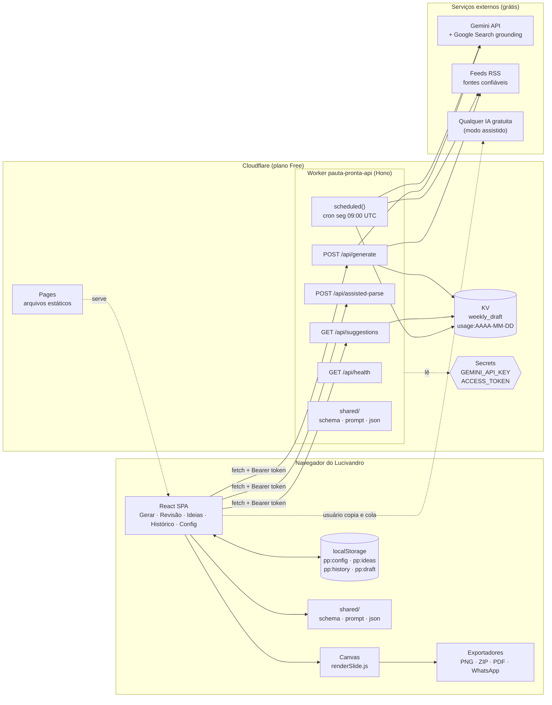
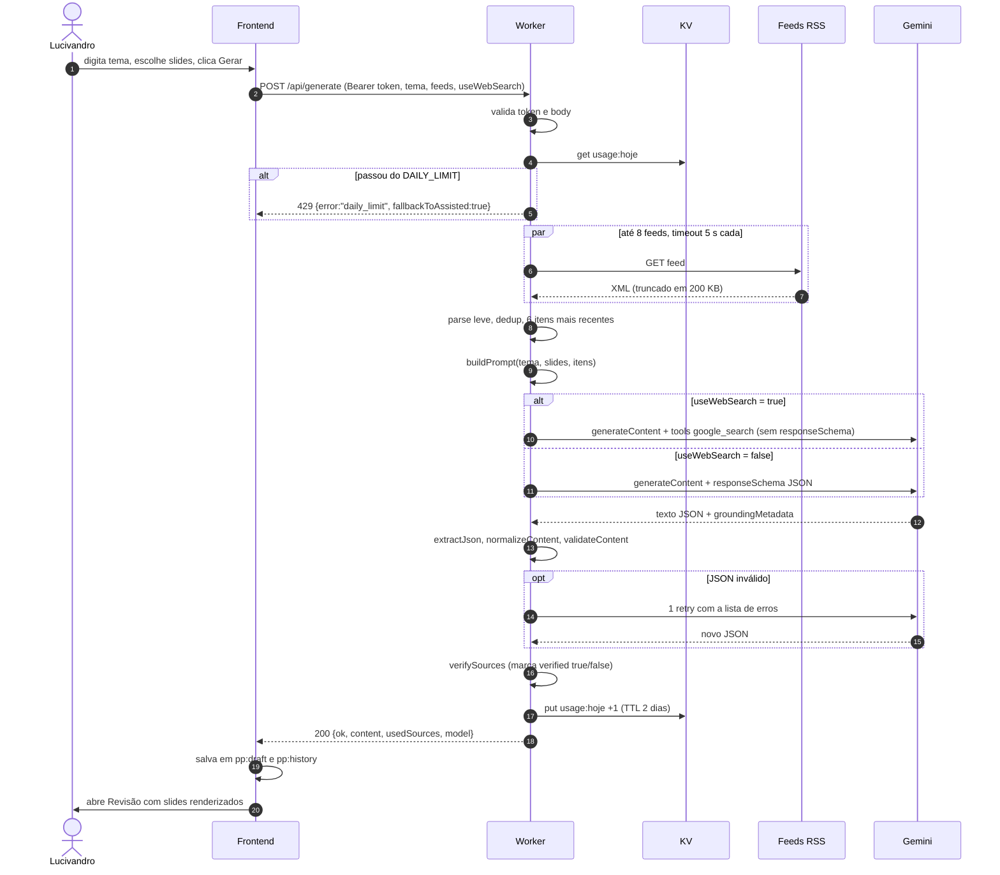
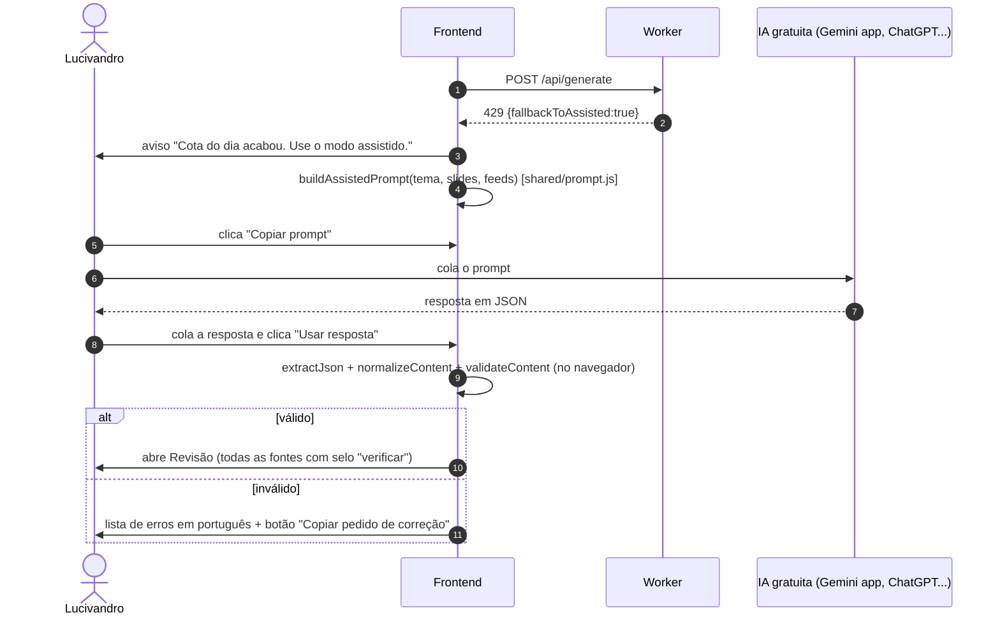
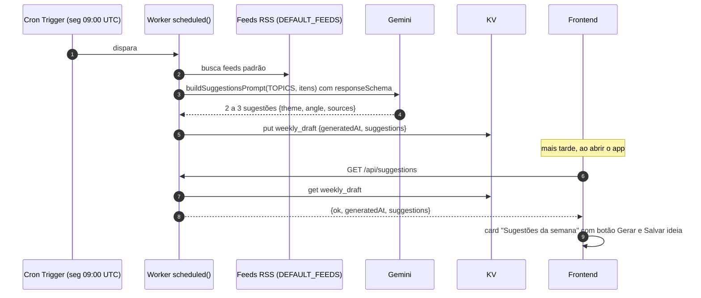
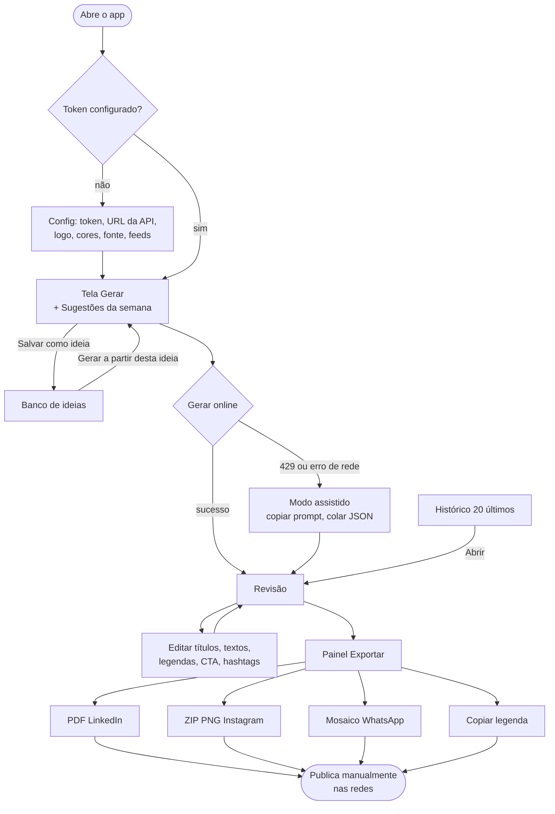
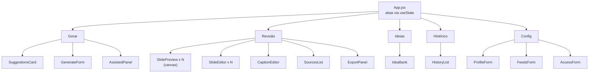
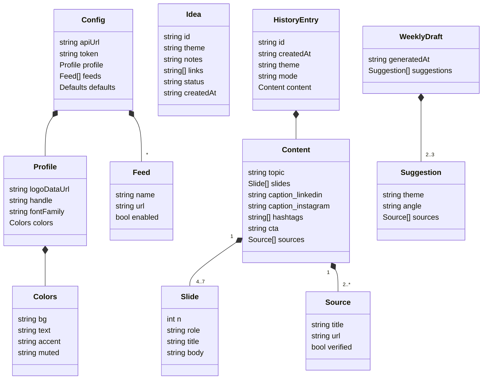
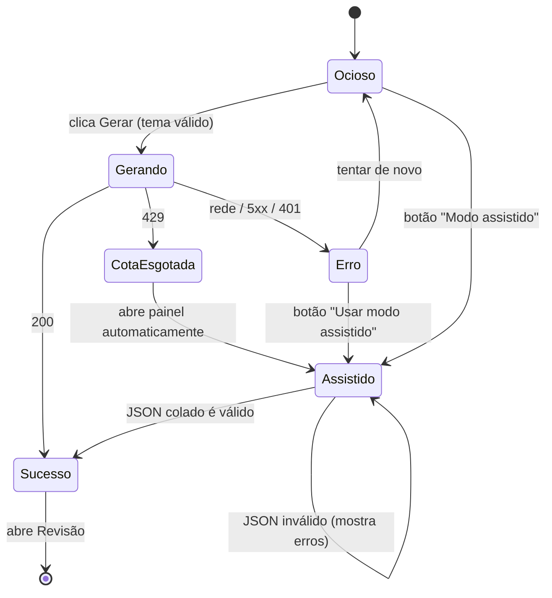
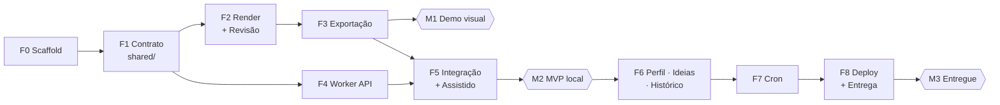
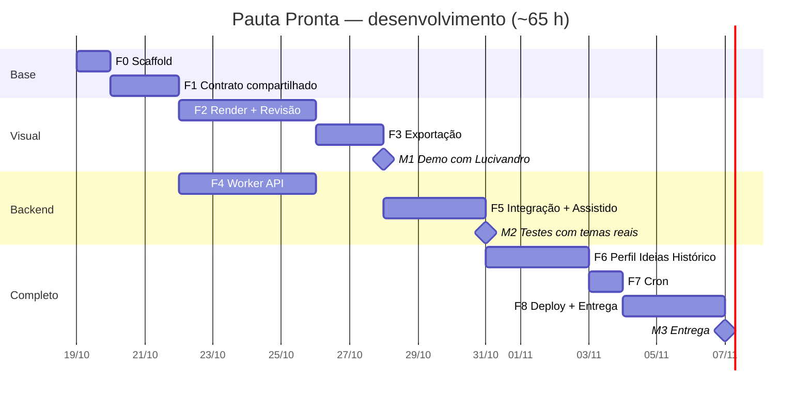

# Pauta Pronta — Diagramas

Todos em Mermaid. Renderizam no Antigravity, no GitHub e no VS Code (com extensão de preview Mermaid).

---

## 1. Arquitetura (componentes)



---

## 2. Sequência — geração online (caminho feliz)



---

## 3. Sequência — cota esgotada e modo assistido



O endpoint `POST /api/assisted-parse` existe (para cumprir o contrato do spec), mas o front valida localmente
com o mesmo código de `shared/`, então o modo assistido funciona **mesmo com o Worker fora do ar**.

---

## 4. Sequência — cron semanal



---

## 5. Fluxo do usuário



---

## 6. Mapa de telas e componentes



---

## 7. Modelo de dados



Limites: `slides` 4 a 7 · `title` até 60 caracteres · `body` até 220 · `hashtags` 3 a 5 · `sources` 2 ou mais.
`role` ∈ `capa | contexto | ponto | conclusao` · `status` da ideia ∈ `nova | usada` · `mode` ∈ `online | assistido`.
`verified` é preenchido pelo app (D8), não pela IA.

Onde cada coisa fica:

| Chave | Onde | Conteúdo |
|---|---|---|
| `pp:config` | localStorage | `Config` |
| `pp:ideas` | localStorage | `Idea[]` |
| `pp:history` | localStorage | `HistoryEntry[]` (máx. 20, mais recente primeiro) |
| `pp:draft` | localStorage | `Content` em edição (salvo a cada mudança, debounce 500 ms) |
| `weekly_draft` | KV | `WeeklyDraft` |
| `usage:AAAA-MM-DD` | KV | número de gerações no dia (TTL 172800 s) |

---

## 8. Estados da tela Gerar



---

## 9. Layout do slide (1080 × 1350)

```text
┌──────────────────────────────────────────┐ ← faixa de destaque (accent), 16 px
│                                          │
│  margem 96 px                            │
│  ┌────────────────────────────────────┐  │
│  │ TÍTULO (bold, 64 px → mín. 44 px)  │  │  capa: título 84 px, centralizado na vertical
│  │ até 3 linhas                       │  │
│  └────────────────────────────────────┘  │
│  ┌────────────────────────────────────┐  │
│  │ Corpo (regular, 40 px → mín. 30 px)│  │  conclusão: corpo + caixa de CTA
│  │ quebra automática, line-height 1.4 │  │  + lista de fontes (26 px, cor muted)
│  │                                    │  │
│  └────────────────────────────────────┘  │
│                                          │
│  [logo máx. 72 px de altura]  @perfil  3/5│ ← rodapé, 64 px da borda
└──────────────────────────────────────────┘
```

---

## 10. Dependência entre fases



F2–F3 e F4 podem andar em paralelo (conversas separadas no Antigravity), desde que F1 esteja pronta.

---

## 11. Cronograma (estimativa)



Ajuste as datas para a sua agenda; o que importa é a ordem.
