# Guia de uso do Pauta Pronta

**Do tema ao carrossel pronto para revisar, em poucos minutos.**

Este guia mostra, passo a passo, como usar o Pauta Pronta para criar carrosséis para o LinkedIn e o Instagram.
Não é preciso instalar nada: a ferramenta funciona no navegador, no computador ou no celular.

**Endereço:** https://pauta-pronta.pages.dev

> **Importante:** a ferramenta monta um **rascunho**. Você sempre revisa o texto e confere as fontes antes de
> publicar. A publicação é feita por você, manualmente: o app nunca posta nada sozinho.

## Sumário

1. Primeiro acesso
2. Ajustar a identidade visual
3. Criar um carrossel
4. Modo assistido (ChatGPT ou Copilot)
5. Revisar e editar os slides
6. Conferir fontes e avisos
7. Exportar e publicar
8. Banco de ideias e histórico
9. Usando no celular
10. Backup dos dados
11. Dúvidas comuns

---

## 1. Primeiro acesso

Na primeira vez, informe o token de acesso. Ele funciona como a senha da ferramenta e é passado por quem instalou
o app.

1. Abra https://pauta-pronta.pages.dev.
2. Clique na aba **Configurações**.
3. Em **Acesso à ferramenta**, confira o endereço (`https://pauta-pronta-api.lucivandro.workers.dev`) e cole o
   **token de acesso**.
4. Clique em **Testar conexão**. A mensagem de sucesso confirma que está tudo certo.

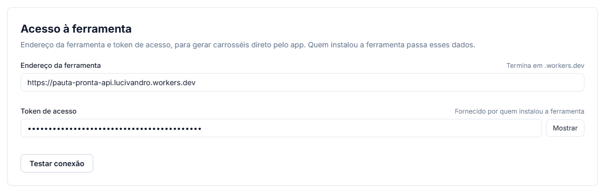

O token fica salvo no navegador. Só é preciso repetir esse passo em outro navegador, em outro aparelho ou depois
de limpar os dados do navegador.

> Não compartilhe o token. Se ele vazar, peça um novo para quem cuida da ferramenta: o antigo para de funcionar.

---

## 2. Ajustar a identidade visual

Ainda em **Configurações**, o quadro **Identidade visual** define como os slides saem. Ele já vem no padrão da
HOTMILK; mude só o que quiser. A **Prévia ao vivo** à direita mostra o resultado na hora.

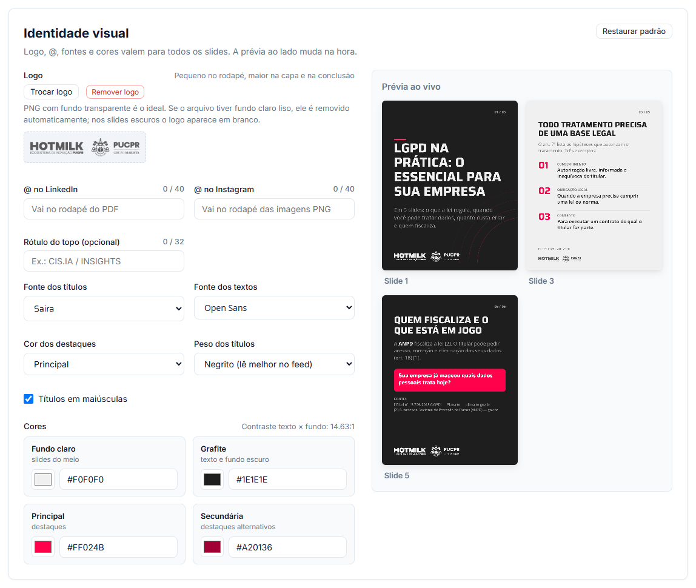

| Campo | Para que serve |
|---|---|
| Logo | Já vem com o logo HOTMILK + PUCPR. Para trocar, envie outro arquivo: o fundo claro é removido automaticamente |
| @ LinkedIn e @ Instagram | O perfil que aparece no rodapé. O do LinkedIn vai no PDF; o do Instagram, nas imagens |
| Rótulo do topo | Texto opcional no alto dos slides, por exemplo `CIS.IA / INSIGHTS` |
| Fontes | Saira nos títulos e Open Sans nos textos (há outras opções) |
| Peso dos títulos | Negrito ou fino, como no site da HOTMILK |
| Cores | Principal, secundária, fundo e texto. A cor dos destaques define o negrito e os números |
| Títulos em maiúsculas | Liga ou desliga as letras maiúsculas nos títulos |

Mais abaixo ficam as **fontes de informação** que a IA usa:

- **Fontes RSS:** sites de notícias que a ferramenta lê a cada geração (HOTMILK, NIST e MIT Technology Review já
  vêm cadastrados). Dá para adicionar, pausar ou remover.
- **Sites de referência:** sites confiáveis sem RSS (Stanford HAI, OCDE, NIST AI RMF, Finep...). Eles entram nas
  instruções do modo assistido como ponto de partida da pesquisa.
- **Padrões de geração:** número de slides, redes, público e tom que já vêm marcados ao abrir a aba Gerar.

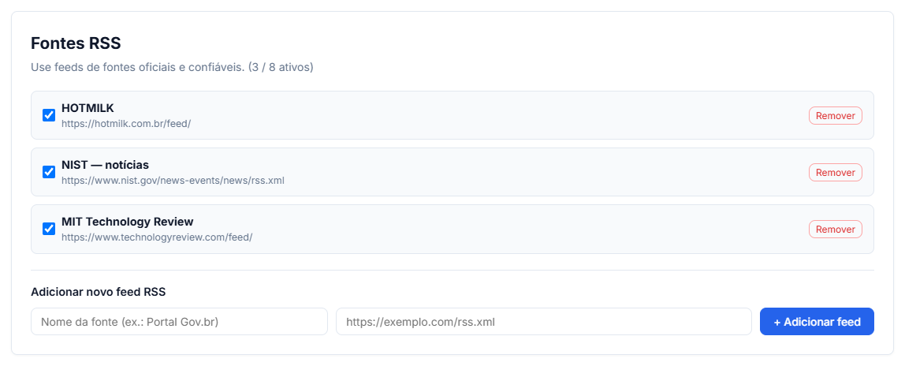

---

## 3. Criar um carrossel

Na aba **Gerar**:

1. Escreva o **tema**. Quanto mais específico, melhor (ex.: "Agentes de IA nas empresas: riscos e boas práticas").
2. Marque as redes (**LinkedIn** e/ou **Instagram**) e o **número de slides** (4 a 7; 5 é o recomendado).
3. Escolha o **público** (gestores, executivos, pesquisadores, startups ou público geral), o **tom** e o
   **formato visual**:
   - **Texto:** slides só com texto;
   - **Infográfico:** a IA usa números em destaque e passos numerados sempre que o conteúdo permite;
   - **Texto + imagem:** textos mais curtos, para você inserir suas imagens depois.
4. Clique em **Gerar carrossel**. Em geral leva de 20 a 60 segundos.

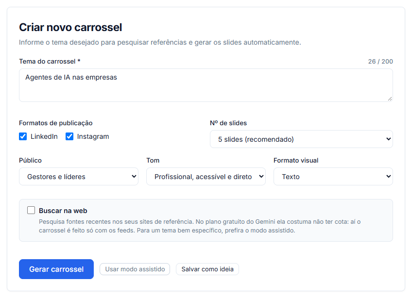

Quando termina, o carrossel abre sozinho na aba **Revisar**.

**Sugestões da semana.** Toda segunda-feira, a ferramenta lê os feeds e sugere 2 ou 3 pautas, com o motivo e a
fonte. Clique em **Usar este tema** para levar a sugestão para o formulário, ou em **Salvar ideia** para
guardar.

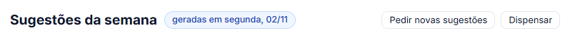

> **Sobre a busca na web:** no plano gratuito do Gemini, a busca na web normalmente não está disponível. Por isso
> ela vem desligada e a IA escreve a partir dos feeds RSS. Para um tema bem específico, que não está nas notícias
> da semana, use o **modo assistido** (próxima seção): é o caminho com melhor resultado.

---

## 4. Modo assistido (ChatGPT ou Copilot)

O modo assistido usa um assistente de IA gratuito (ChatGPT, Microsoft Copilot ou outro) para pesquisar e escrever o
carrossel. Ele não depende da cota da ferramenta e não tem custo. Use quando:

- o tema é específico e precisa de pesquisa na web;
- a cota diária da ferramenta acabou (o app abre o modo assistido sozinho);
- a ferramenta está fora do ar.

**Passo a passo:**

1. Na aba **Gerar**, escreva o tema, ajuste as opções e clique em **Usar modo assistido**.
2. **Passo 1:** clique em **Copiar prompt**.
3. Abra o [ChatGPT](https://chatgpt.com) ou o [Copilot](https://copilot.microsoft.com), cole e envie.
4. O assistente responde com um bloco de código (começa com ` ```json `). Copie a resposta inteira.
5. **Passo 2:** cole na caixa da direita e clique em **Usar resposta**.

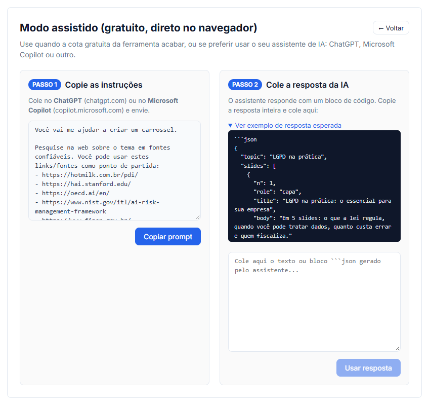

Se algo vier fora do formato, o app mostra o problema em palavras simples e gera um **pedido de correção**: copie,
cole no mesmo chat do assistente e repita o passo 5 com a nova resposta. O link **Ver exemplo de resposta
esperada** mostra como a resposta deve ser.

---

## 5. Revisar e editar os slides

A aba **Revisar** mostra os slides à esquerda (para editar) e a **Visualização ao vivo** à direita. Toda alteração
aparece na hora.

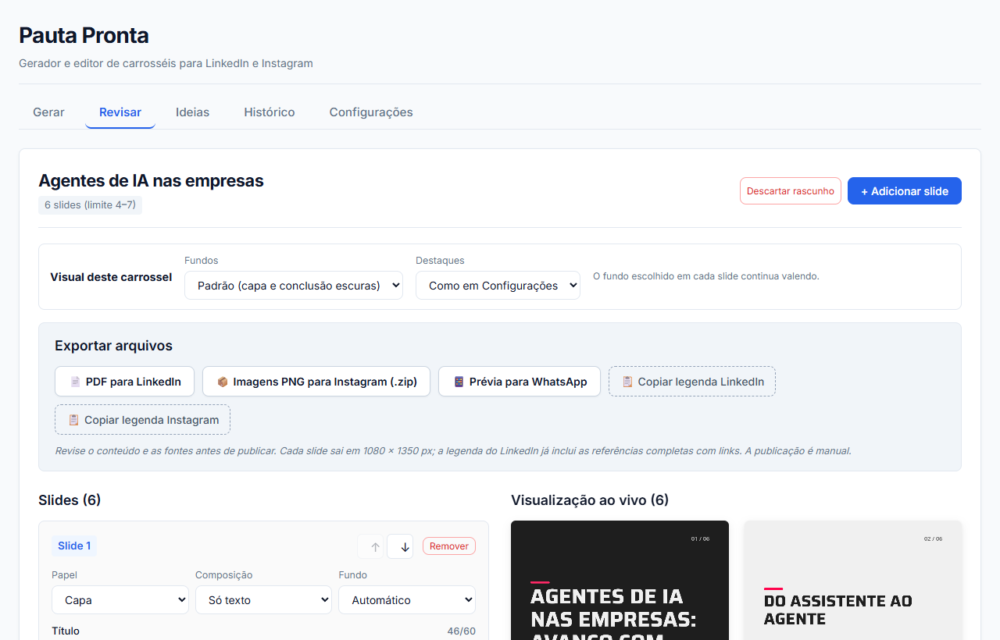

### Visual deste carrossel

No topo, **Visual deste carrossel** muda só o carrossel aberto, sem mexer nas Configurações:

- **Fundos:** padrão (capa e conclusão escuras), todos escuros ou todos claros;
- **Destaques:** a cor do negrito e dos números (principal ou secundária).

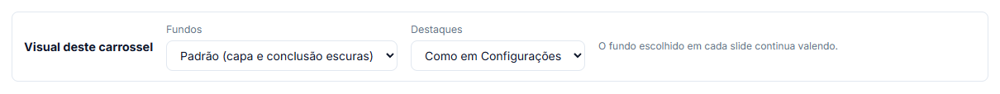

### Editando um slide

Cada slide tem:

| Campo | O que faz |
|---|---|
| ↑ ↓ | Muda a ordem do slide |
| Remover | Apaga o slide (o carrossel precisa de 4 a 7) |
| Papel | Capa, contexto, conteúdo ou conclusão |
| Composição | Só texto, número em destaque, passos numerados ou imagem (em cima, ao lado, de fundo) |
| Fundo | Automático, claro ou escuro, só para este slide |
| Título e Texto | O contador mostra o tamanho; fica vermelho quando passa do limite |
| **B Negrito** | Selecione uma ou duas palavras e clique: no slide, elas saem na cor de destaque |
| Fonte deste slide | Uma linha curta no pé do slide, ex.: `Fonte: Gartner, 2025 [2]` |

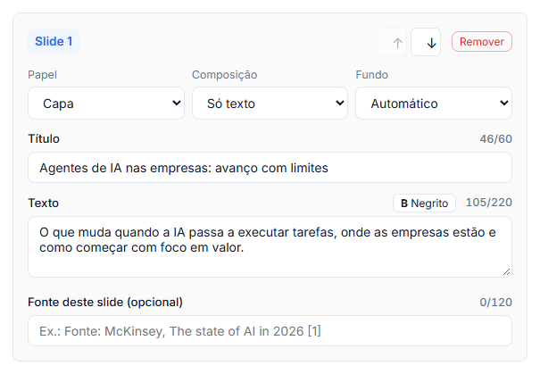

Para adicionar um slide, use **+ Adicionar slide** no topo. Para começar outro carrossel do zero, use
**Descartar rascunho**.

### Número em destaque e passos numerados

- **Número em destaque:** para um dado forte das fontes (ex.: `40%`). Preencha o número e explique no texto.
- **Passos numerados:** para processos, etapas ou checklists. Use de 2 a 4 passos, cada um com rótulo curto e
  uma frase.

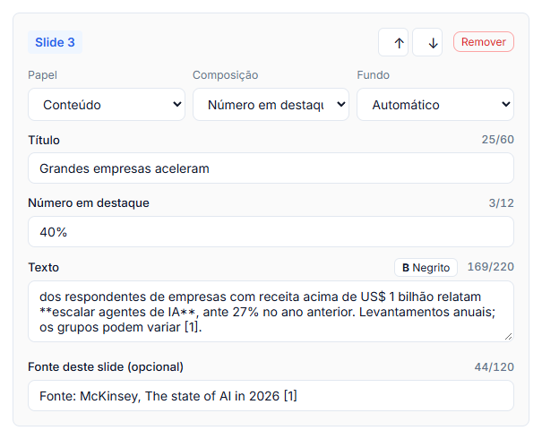

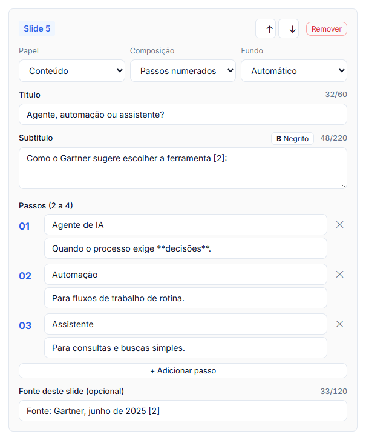

### Inserindo uma imagem

A ferramenta não cria imagens: você insere uma foto, ilustração ou print seu (PNG, JPG ou WebP).

1. Em **Composição**, escolha **Imagem em cima**, **Imagem ao lado** ou **Imagem de fundo**.
2. Clique em **Inserir imagem** e escolha o arquivo.
3. Ajuste o enquadramento com **Zoom**, **Horizontal** e **Vertical**. **Centralizar** volta ao padrão.

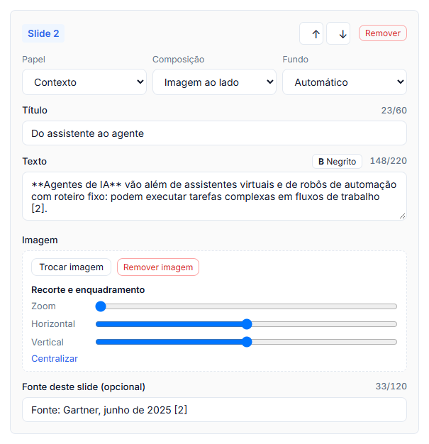


> Use só imagens suas ou com direito de uso.

---

## 6. Conferir fontes e avisos

Antes de exportar, confira duas coisas:

**Avisos de revisão.** O quadro amarelo no topo aponta textos longos demais ou campos faltando. Quando um texto não
cabe, a letra diminui até um tamanho mínimo e o slide mostra **"texto não coube"**: resuma até o aviso sumir.

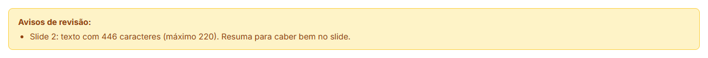

**Fontes de referência.** É a lista das fontes citadas, numeradas como no texto (`[1]`, `[2]`...). Uma fonte com o
selo **"verificar"** não estava entre os sites consultados: abra o link e confira antes de publicar. Você pode
corrigir, remover ou adicionar fontes.

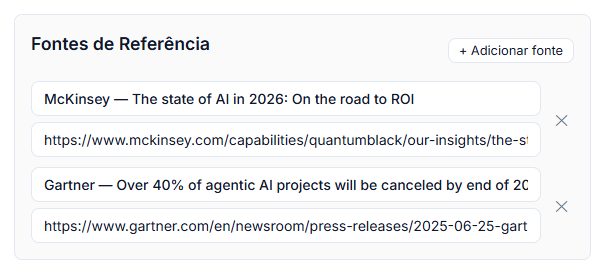

**Legendas.** O quadro **Legendas e Publicação** traz a legenda do LinkedIn (mais analítica), a do Instagram (mais
direta), as hashtags e a pergunta final. Tudo é editável.

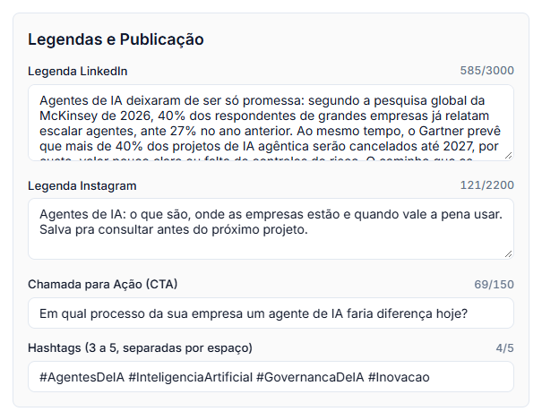

---

## 7. Exportar e publicar

O painel **Exportar arquivos** fica no topo da aba Revisar.

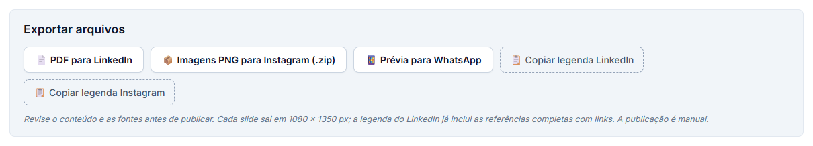

| Botão | O que gera | Como publicar |
|---|---|---|
| PDF para LinkedIn | Um PDF com um slide por página | No LinkedIn: **Começar publicação → Adicionar documento**, envie o PDF e dê um título |
| Imagens PNG para Instagram (.zip) | Um arquivo .zip com `slide-01.png`, `slide-02.png`... (1080×1350) | Descompacte e publique as imagens em ordem, como carrossel |
| Prévia para WhatsApp | Uma imagem com todos os slides em grade | Para mostrar o rascunho a alguém antes de publicar |
| Copiar legenda LinkedIn | Legenda, pergunta, hashtags e referências com links | Cole no texto do post |
| Copiar legenda Instagram | Legenda, pergunta e hashtags | Cole na legenda do post |

Cada slide também tem o botão **Baixar PNG** na visualização ao vivo.

**Resultado:** o carrossel "Agentes de IA nas empresas", feito com a ferramenta:

| | | |
|---|---|---|
|  |  | 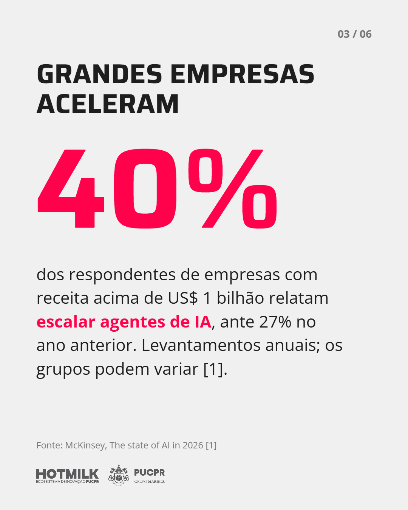 |
| 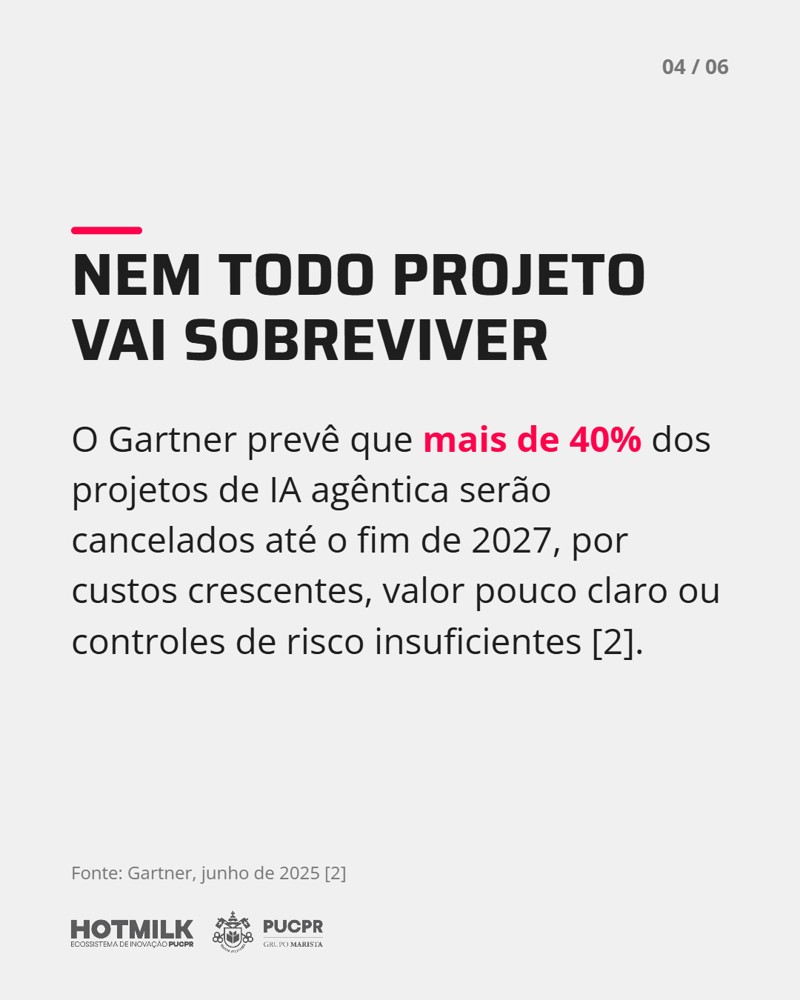 | 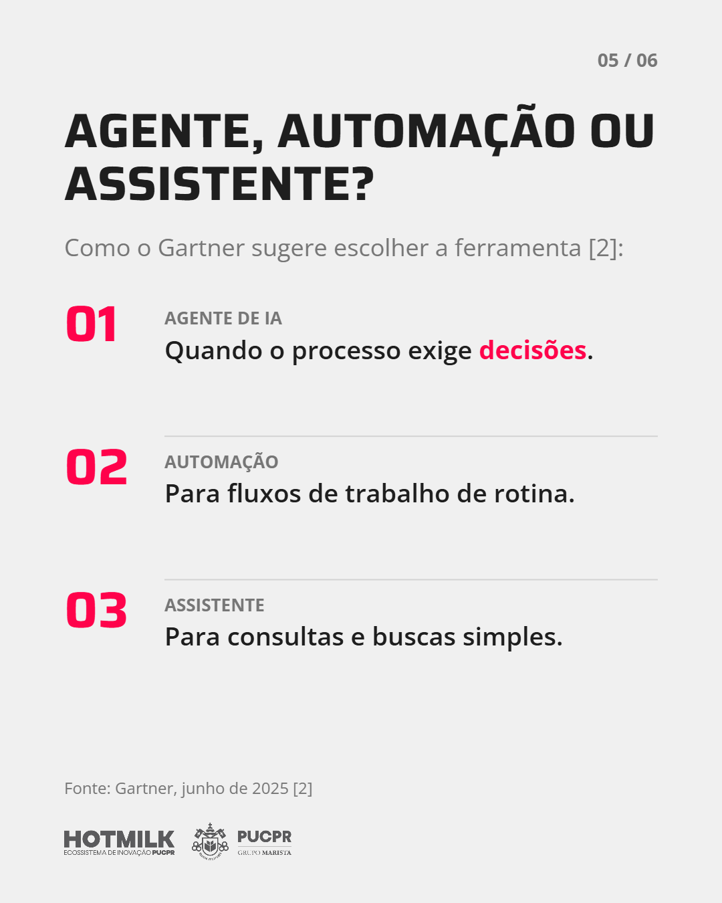 | 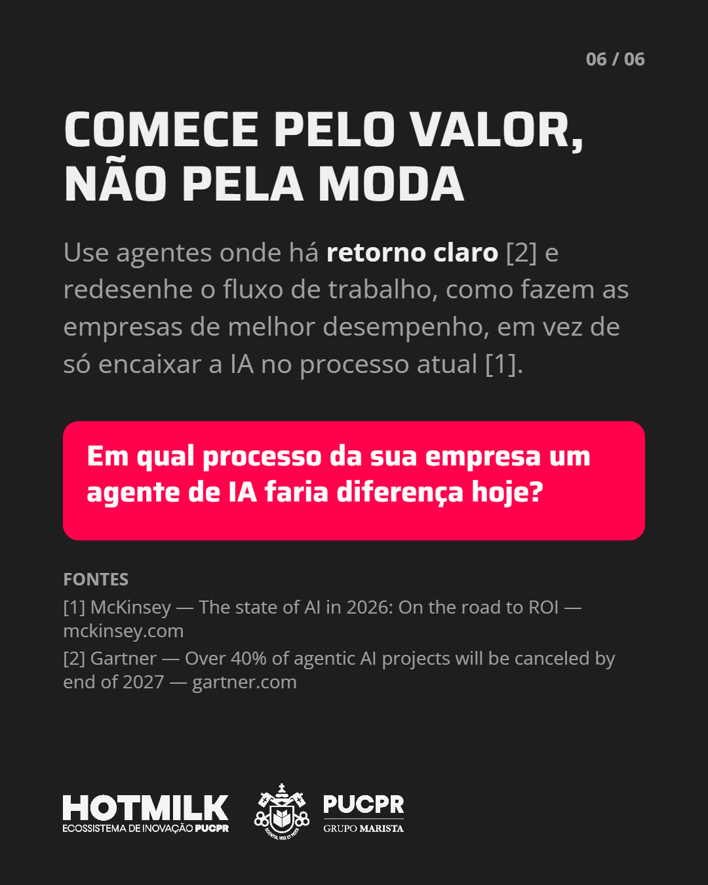 |

---

## 8. Banco de ideias e histórico

**Ideias.** Guarde temas para depois, com anotações e links. A busca ignora acentos. **Gerar a partir desta ideia**
leva o tema para a aba Gerar; depois de gerado, a ideia fica marcada como usada.

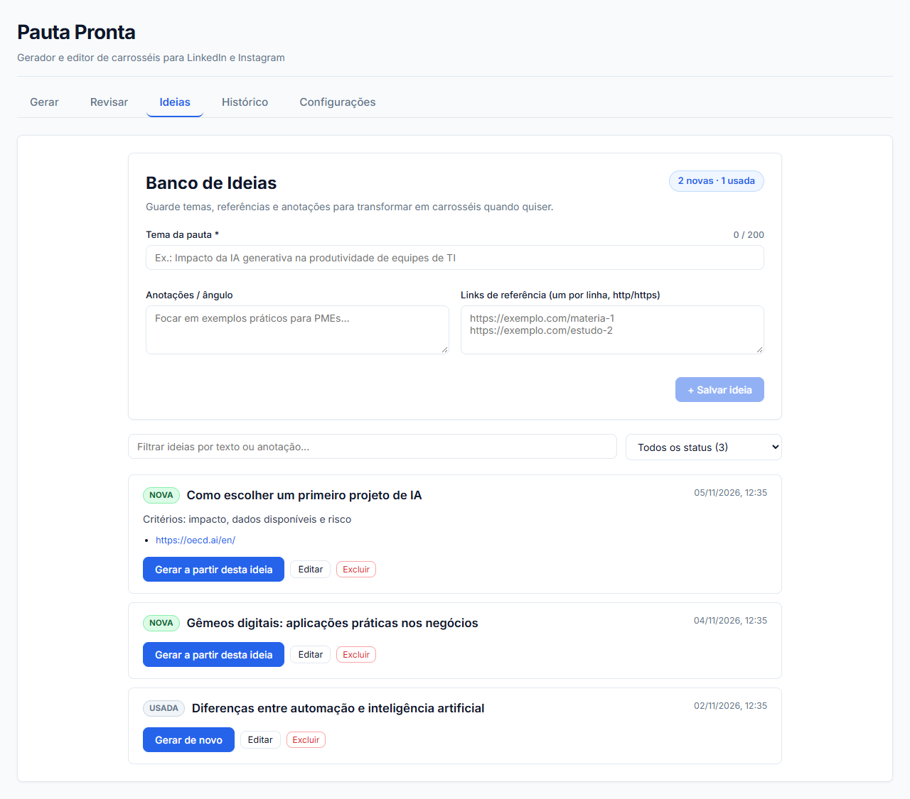

**Histórico.** As 20 últimas gerações ficam guardadas. **Abrir na revisão** traz um carrossel de volta para
editar ou exportar de novo; **Reusar como ideia** guarda o tema no banco de ideias.

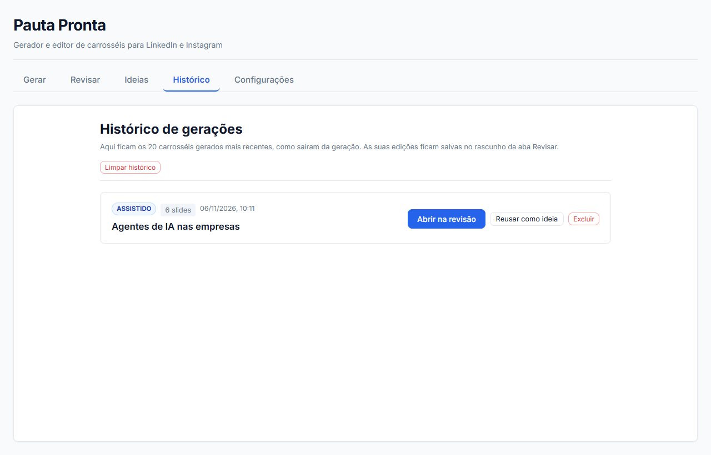

---

## 9. Usando no celular

O app funciona no navegador do celular. Na aba Revisar, use o seletor **Editar / Prévia** no topo para alternar
entre os campos e os slides.

| | | |
|---|---|---|
| 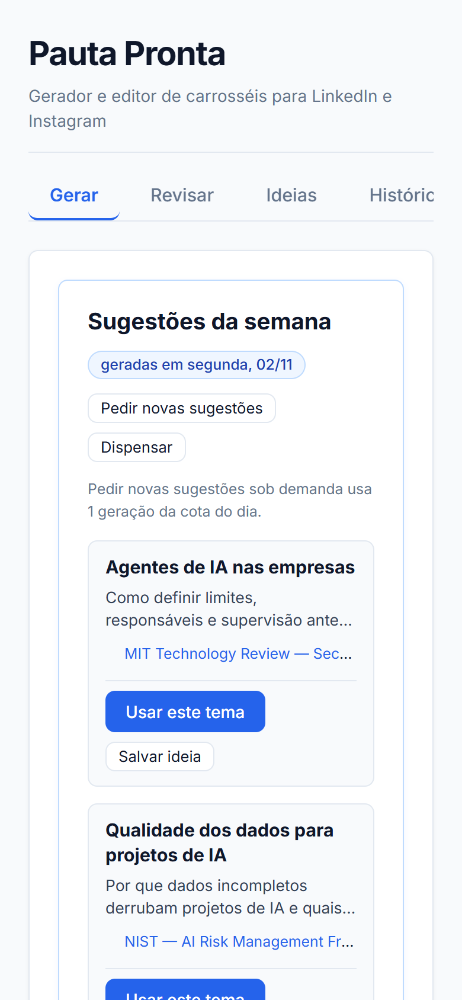 | 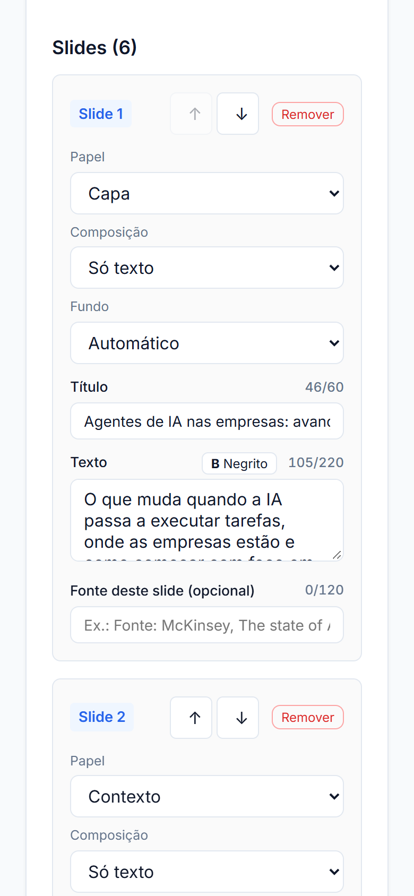 | 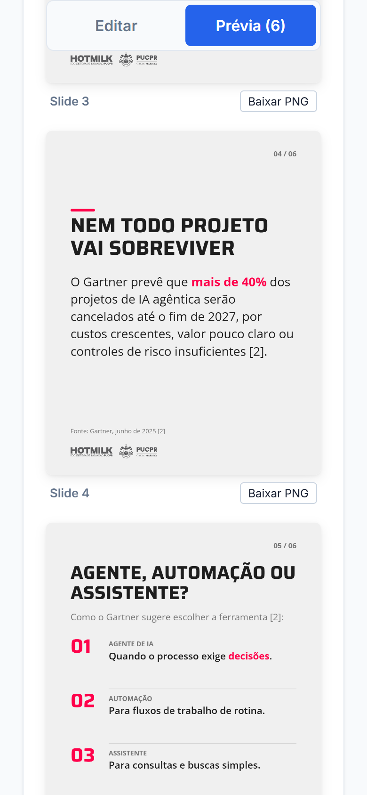 |

---

## 10. Backup dos dados

Ideias, histórico e configurações ficam **só no seu navegador**: nada vai para um servidor. Se os dados do navegador
forem limpos, eles se perdem. Por isso, de vez em quando:

1. Vá em **Configurações → Backup dos dados**.
2. Clique em **Baixar backup** e guarde o arquivo.
3. Para recuperar (ou levar para outro computador), use **Restaurar backup**.

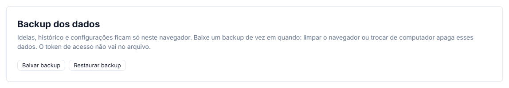

O token de acesso não vai no backup: depois de restaurar, cole o token de novo.

---

## 11. Dúvidas comuns

| O que aparece | O que fazer |
|---|---|
| "Token inválido" | Cole o token de novo em Configurações, sem espaços no começo ou no fim |
| "A cota gratuita acabou por hoje" | Use o modo assistido. A cota volta no dia seguinte |
| "A busca na web não está disponível agora" | Normal no plano gratuito: o carrossel usa os feeds. Para um tema específico, use o modo assistido |
| "A IA respondeu com erro" ou "não gerou uma resposta válida" | Tente de novo em alguns minutos ou use o modo assistido |
| "Sem conexão com o servidor" | Confira a internet e o endereço em Configurações → Acesso à ferramenta |
| "Não consegui ler" um feed | O site do feed está fora do ar. A geração continua com os outros feeds |
| Fonte com selo "verificar" | Abra o link e confira. Se não servir, troque ou remova |
| Texto pequeno ou "texto não coube" | Resuma o texto até o contador ficar cinza |
| O carrossel saiu fora do tema | Os feeds da semana não tratavam do assunto. Use o modo assistido |
| Ideias e histórico sumiram | Restaure o último backup em Configurações → Backup dos dados |

**Antes de publicar, sempre:**

- [ ] li todos os slides e as legendas;
- [ ] abri as fontes com selo "verificar";
- [ ] conferi números e datas com a fonte original;
- [ ] nenhum aviso de "texto não coube".
